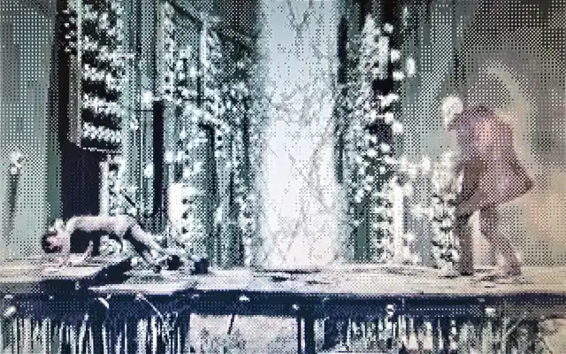

# MD/MJPEG

Microfirmware for the [SidecarTridge Multi-device](https://sidecartridge.com) by [Neil Rackett](https://x.com/neilrackett)

## Introduction



MD/MJPEG turns your SidecarTridge Multi-device into a video player for your Atari ST: drop an `.AVI` file onto the SD card and it plays full-screen, full-motion video with sound on a stock ST — no hard drive, no accelerator, no extra hardware.

Every frame is decoded from MJPEG on the SidecarT's RP2040, quantized to a fresh 16-colour palette (median cut + 2×2 Bayer dither, so each frame gets the best colours the ST can show), and blitted to the screen over the cartridge port at up to 25 fps. Sound plays through the YM2149 at ~5.6 kHz. Video and audio stay in sync by design: the audio clock paces the video, and busy scenes drop frames rather than drift.

The app plays the first `.AVI` it finds in the `/mjpeg` folder of the SD card (configurable in Booster), loops at the end, and returns to GEM when you press **ESC**.

## Installation

1. Download the latest files from the releases page.
2. Copy the `.uf2` and `.json` files to the `/apps` folder of your SidecarT's microSD card.
3. On the Booster screen, press ESC for the app list and select the MD/MJPEG app.
4. Copy a converted `.AVI` file (see below) into the `/mjpeg` folder of the SD card.
5. To return to Booster, power on while holding SELECT.

## Converting a video

Videos need converting to the format the firmware streams: 320×200 MJPEG at 25 fps with 8-bit mono PCM audio, in a standard AVI container. The `tools/video_to_avi.sh` script does it all with [ffmpeg](https://ffmpeg.org) (`brew install ffmpeg` on macOS, `apt install ffmpeg` on Debian/Ubuntu).

For example, to convert the open-movie classic [Elephants Dream](https://archive.org/download/ElephantsDream):

```bash
# 1. Download the source video (any resolution works; it gets
#    centre-cropped and scaled to fill the ST's 320x200 screen)
curl -LO https://archive.org/download/ElephantsDream/ed_1024_512kb.mp4

# 2. Convert it
tools/video_to_avi.sh ed_1024_512kb.mp4 ED.AVI

# 3. Copy ED.AVI to the /mjpeg folder of your SidecarT's SD card
```

The output is a normal AVI — you can preview it in VLC or any desktop player before copying it over.

An optional third argument sets the MJPEG quality (2 = best, 31 = worst, default 9). It's a speed dial as much as a quality dial: the RP2040 decodes every frame in real time, so _lower_ numbers make frames slower to decode and can cause dropped frames, while the ST's 16-colour dither hides most of the difference anyway. If playback looks choppy, try a higher number (e.g. 11).

## Known limitations

- Colour systems only (ST low-res, 320×200); high-res mono screens fall back to GEM.
- For maximum compatibility, sound is mono, ~5.6 kHz and effectively 6-bit playing via the ST's YM2149 sound chip. Think telephone, not hi-fi.
- Very busy scenes can exceed the per-frame decode budget; the player skips frames to keep the audio smooth and the picture in sync.
- It plays the first `.AVI` it finds — there's no file selection menu.

## What's next?

A few ideas we've had (no promises we'll do them all):

- A file selection menu for cards with more than one video
- Pause / seek controls
- Squeezing out the last few ms per frame for rock-solid 25 fps
- Better audio quality modes
- STE audio support

Think you can help? Got an idea of your own? We'd love to hear from you, so why not let me know on [X](https://x.com/neilrackett) or submit a PR.

## Credits

Built from the [md-framebuffer-template](https://github.com/sidecartridge/md-framebuffer-template) for the SidecarTridge Multi-device, with JPEG decoding by Larry Bank's excellent [JPEGDEC](https://github.com/bitbank2/JPEGDEC) (Apache-2.0).

## License

The source code of the project is licensed under the GNU General Public License v3.0. The full license is accessible in the [LICENSE](LICENSE) file.
